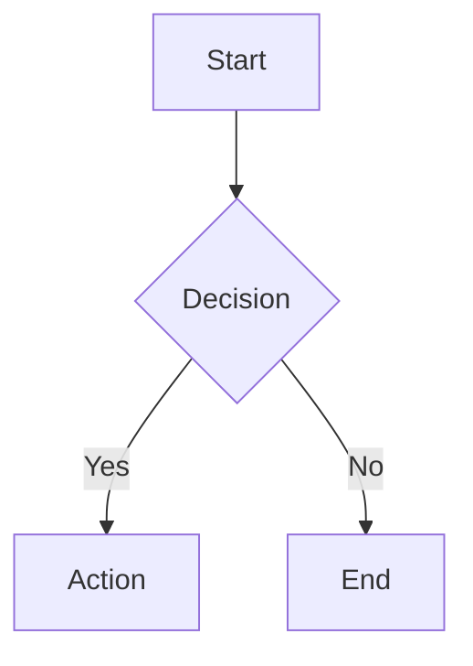

# Features Guide

[← Back to Index](./DEVPOPS_INDEX.md) | [← FWK Runtime](./05_FWK_RUNTIME.md)

## Overview

This guide covers all major features of devpops, organized by use case. Each feature includes requirements, usage instructions, and tips.

## Feature Categories

1. [Repository Analysis](#repository-analysis)
2. [Developer Tools](#developer-tools)
3. [UI Enhancements](#ui-enhancements)
4. [Debugging & Testing](#debugging--testing)
5. [System Administration](#system-administration)

---

## Repository Analysis

### 1. Dependency Finder (23.6+) ⭐ Flagship Feature

**Purpose:** Find all dependencies for any repository object

**Requirements:**
- Siebel 23.6+
- REST API enabled
- devpops 24.5+

**How to Use:**

1. **Access the Feature:**
   - Click Debug Menu → Repository → Dependency Finder
   - Or right-click any object → Find Dependencies

2. **Select Object:**
   ```
   Object Type: [Dropdown - Applet/BC/View/etc]
   Object Name: [Text input or picker]
   Workspace: [Current or select]
   ```

3. **Scan Options:**
   - **References** - Objects that reference this object
   - **Dependencies** - Objects this depends on
   - **Scripts** - Script references
   - **Open UI** - JavaScript file references

4. **View Results:**
   - **Tree View** - Hierarchical navigation
   - **Graph View** - Visual dependency graph
   - **Export** - CSV/JSON export options

**Supported Objects:**
- Applet, Business Component, Business Object
- View, Screen, Application
- Business Service, Workflow Process
- Table, Column, Index
- Integration Object, Web Service
- 20+ object types total

**Example Use Cases:**
- Impact analysis before changes
- Understanding object relationships
- Finding unused objects
- Migration planning

### 2. Workflow Visualizer (24.12) 🆕

**Purpose:** Generate visual diagrams of workflow processes

**Requirements:**
- Siebel 23.6+
- Mermaid.js (auto-loaded)
- devpops 24.12

**How to Use:**

1. **Select Workflow:**
   - Debug Menu → Workflow → Visualize
   - Or from Workflow Process List View

2. **Choose Display Mode:**
   - **Simple** - Basic flow
   - **Detailed** - All properties
   - **Compact** - Minimal labels

3. **Interact with Diagram:**
   - **Zoom** - Mouse wheel
   - **Pan** - Click and drag
   - **Export** - PNG/SVG/Print

**Diagram Elements:**


**Features:**
- Decision branches visualization
- Subprocess expansion
- Step properties display
- Error handling paths

### 3. ERD Viewer (Entity Relationship Diagrams)

**Purpose:** Visualize Business Object relationships

**How to Use:**

1. **Select Business Object:**
   - Debug Menu → Repository → ERD Viewer
   - Choose BO or View

2. **Generated Diagram Shows:**
   - Business Components
   - Links and Joins
   - Field relationships
   - Cardinality

**Export Options:**
- Mermaid syntax
- Image (PNG/SVG)
- Documentation format

---

## Developer Tools

### 4. X-Ray Metadata Viewer

**Purpose:** See all metadata layers in the UI

**Modes:**

1. **Show Controls** (Ctrl+Alt+1)
   - Displays control names in labels
   - Shows control types

2. **Show BC Fields** (Ctrl+Alt+2)
   - Shows business component fields
   - Field data types

3. **Show Table Columns** (Ctrl+Alt+3)
   - Physical table names
   - Column mappings

4. **Silent Export** (Ctrl+Alt+X)
   - Scans entire view
   - Exports to clipboard
   - Formats: CSV, HTML, Excel

**Usage Tips:**
- Hold Shift for tooltip-only mode
- Right-click for context menu
- Export for documentation

### 5. Business Service Runner

**Purpose:** Test any business service method

**How to Use:**

1. **Open Runner:**
   - Debug Menu → Tools → BS Runner
   - Keyboard: Ctrl+Alt+B

2. **Configure:**
   ```
   Service: [Select from dropdown]
   Method: [Select from dropdown]
   ```

3. **Input Parameters:**
   - Dynamic form generation
   - PropertySet editor
   - JSON input option

4. **Execute & Review:**
   - View outputs
   - Copy results
   - Save as preset

**Advanced Features:**
- Workflow property detection
- Input validation
- Performance timing
- Result formatting

### 6. Workspace Management

**Purpose:** Enhanced workspace operations

**Features:**

1. **Fast Inspect:**
   - Quick preview without losing context
   - Right-click workspace icon
   - Keyboard: Ctrl+Alt+W

2. **Modified Objects View:**
   - See who's working on what
   - Version tracking
   - Quick navigation

3. **Workspace History:**
   - Track changes over time
   - Compare versions
   - Rollback options

### 7. Web Tools Enhancements

**Purpose:** Productivity improvements for Web Tools

**Features:**

1. **Screen Menu:**
   - Quick screen navigation
   - Recently used screens
   - Favorites

2. **Register View with Responsibility:**
   - Right-click in Screen Views list
   - Auto-populate fields
   - Batch operations

3. **Context Menus:**
   - Right-click on any object
   - Quick actions
   - Copy/paste support

4. **Workflow Editor Improvements:**
   - Open BS from workflow step
   - Quick property edit
   - Visual indicators

---

## UI Enhancements

### 8. Debug Menu

**Purpose:** Central hub for all devpops features

**Access:**
- Click floating cube icon
- Keyboard: Ctrl+Alt+D
- Customize position/appearance

**Customization:**
- Drag to reposition
- Right-click to customize
- Save preferences

**Menu Structure:**
- X-Ray tools
- Repository tools
- Workflow tools
- System tools
- User preferences

### 9. Dark Mode

**Purpose:** Reduce eye strain with dark theme

**Toggle:**
- Debug Menu → UI → Toggle Dark Mode
- Keyboard: Ctrl+Alt+T

**Features:**
- Complete UI theming
- Preserved across sessions
- Custom color variables

### 10. List Applet Enhancements

#### Lizard 2.0 - Column Wizard

**Purpose:** Dynamic column management

**Access:**
- Click 🦎 button on list applets
- Or Debug Menu → Tools → Lizard

**Features:**
- Show/hide columns
- Reorder columns
- Auto-resize
- Save to repository

#### Auto-Resize Columns

**Purpose:** Optimal column widths

**How to Use:**
- Click resize button
- Or right-click → Auto Resize

**Options:**
- Fit to content
- Fit to header
- Custom constraints

### 11. Pretty Banner

**Purpose:** Enhanced application banner

**Features:**
- Workspace display
- User info
- Quick actions
- Custom styling

---

## Debugging & Testing

### 12. Trace & Logging

**Purpose:** SQL and allocation tracing

**Start Tracing:**
1. Debug Menu → Tools → Start Trace
2. Select trace types:
   - SQL statements
   - Memory allocation
   - Object manager

**View Logs:**
- In-browser viewer
- Syntax highlighting
- Search and filter
- Export options

### 13. SARM (Siebel ARM)

**Purpose:** Performance monitoring

**Enable:**
```
Debug Menu → System → SARM On
Options:
- Component: [Select]
- Group By: Area/Subarea/Workflow
```

**View Statistics:**
- Real-time updates
- Sort by duration
- Export to CSV

### 14. Test Automation Support

**Purpose:** Prepare for automated testing

**Features:**

1. **Test IDs:**
   - Automatic generation
   - Unique identifiers
   - DISA compliance

2. **Readiness Wizard:**
   - Check configuration
   - Generate test cases
   - Validation checklist

**Test ID Format:**
```html
<button aria-test-name="BCRM_QWNjb3VudExpc3Q=">
```

### 15. Server Manager Integration

**Purpose:** Run srvrmgr commands from browser

**Requirements:**
- Siebel Administrator responsibility
- BCRM Server Manager Service configured

**Commands:**
```
list components
list tasks for server SIEBEL1
change param MaxTasks=100 for comp CallCenter
```

**Access:**
- Debug Menu → System → Server Manager
- Enter commands directly
- View results in browser

---

## System Administration

### 16. Component Status Monitor

**Purpose:** Monitor server components

**Features:**
- Real-time status
- Start/stop components
- Resource usage
- Alert thresholds

### 17. Log Viewer

**Purpose:** View server logs in browser

**Setup Required:**
1. Edit logviewer.html with server details
2. Create symlink for log access
3. Access via Debug Menu

**Monitored Logs:**
- UI.log
- RESTInBoundDefault.log
- siebel_1.log
- Component logs

### 18. Storage Manager

**Purpose:** Manage persistent storage

**Features:**
- JSON editor
- Import/export
- Clear storage
- Usage statistics

**Storage Types:**
- User preferences
- Menu customization
- Column configurations
- Cache data

### 19. About View Enhancements

**Purpose:** Enhanced system information

**Features:**
- Detailed version info
- Workspace history
- Real-time property viewer
- Quick navigation to Web Tools

**Access:**
- Help → About View
- Click "Get Lucky" for live view

### 20. Property Set Viewer

**Purpose:** Visualize PropertySet structures

**Features:**
- Tree navigation
- Search within PS
- Copy values
- Export to JSON

---

## Keyboard Shortcuts

### Essential Shortcuts

| Shortcut | Action |
|----------|--------|
| Ctrl+Alt+D | Toggle Debug Menu |
| Ctrl+Alt+X | X-Ray Silent Export |
| Ctrl+Alt+1 | Show Controls |
| Ctrl+Alt+2 | Show BC Fields |
| Ctrl+Alt+3 | Show Table Columns |
| Ctrl+Alt+W | Fast Inspect Workspace |
| Ctrl+Alt+B | Business Service Runner |
| Ctrl+Alt+T | Toggle Dark Mode |
| Ctrl+Alt+R | Refresh View |

### Context Modifiers

| Modifier | Effect |
|----------|--------|
| Shift+Click | Additional options |
| Shift+Right-Click | Developer context menu |
| Alt+Click | Quick actions |
| Ctrl+Click | Multi-select |

---

## Tips & Best Practices

### Performance

1. **Use Caching:**
   - Dependency scans are cached
   - Clear cache when needed
   - Cache timeout: 1 hour

2. **Batch Operations:**
   - Select multiple objects
   - Use filters effectively
   - Export for offline analysis

### Workflow

1. **Create Presets:**
   - Save BS runner configs
   - Menu customization
   - Column preferences

2. **Use Keyboard Shortcuts:**
   - Faster navigation
   - Reduced clicks
   - Improved productivity

### Troubleshooting

1. **If Features Don't Appear:**
   - Check version compatibility
   - Verify REST API configuration
   - Clear browser cache

2. **Performance Issues:**
   - Reduce scan depth
   - Use filters
   - Clear old cache

3. **Export Problems:**
   - Check clipboard permissions
   - Try different formats
   - Use file export option

---

## Feature Comparison by Version

| Feature | 20.12 | 23.6 | 24.12 |
|---------|-------|------|-------|
| Core Features | ✅ | ✅ | ✅ |
| Dependency Finder | ❌ | ✅ | ✅ |
| Workflow Visualizer | ❌ | ❌ | ✅ |
| SIF Viewer | ❌ | ❌ | ✅ |
| REST API Features | Limited | Full | Enhanced |
| Performance | Good | Better | Best |

---

## Next Steps

- For installation → [Installation Guide](./07_INSTALLATION.md)
- For technical details → [Technical Reference](./08_TECHNICAL.md)
- For troubleshooting → [Installation Guide](./07_INSTALLATION.md#troubleshooting)

---

[← FWK Runtime](./05_FWK_RUNTIME.md) | [Back to Index](./DEVPOPS_INDEX.md) | [Next: Installation →](./07_INSTALLATION.md)